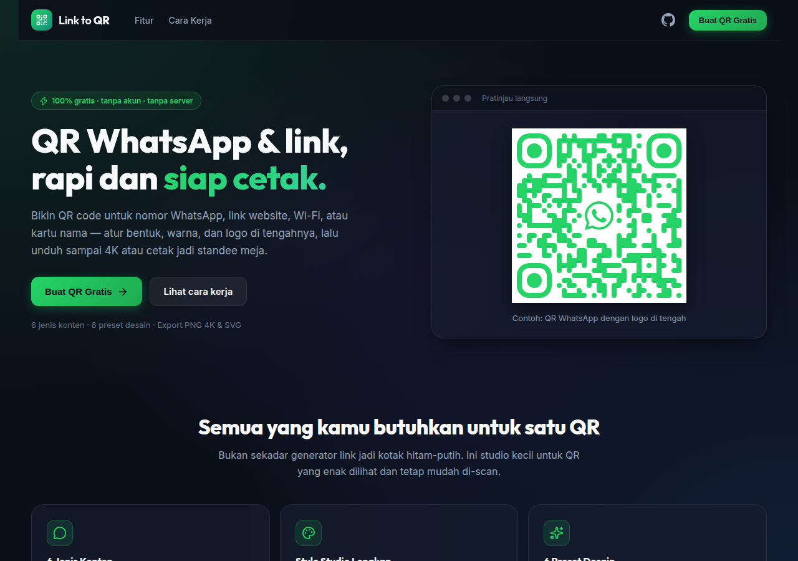
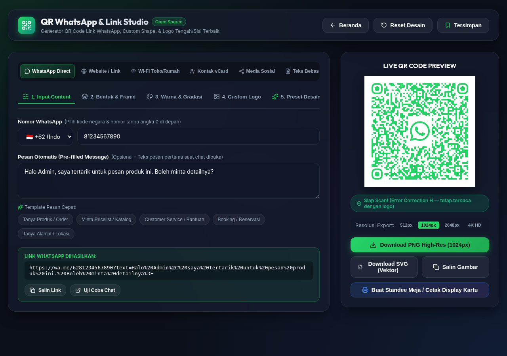

# Link to QR

**QR WhatsApp & Link Studio** — generator QR code untuk nomor WhatsApp, link website, Wi-Fi, kontak vCard, media sosial, dan teks bebas. Atur bentuk titik, frame sudut, gradasi warna, dan logo di tengah, lalu unduh PNG sampai 4K atau SVG vektor. Semua diproses di browser: gratis, tanpa akun, tanpa server.

🌐 **Live:** https://qr-link.pages.dev
💻 **Repo:** https://github.com/dezzorigin/link-to-qr

[](https://github.com/dezzorigin/link-to-qr/actions/workflows/ci.yml)


## Tampilan




🎬 **Video demo** — klik thumbnail untuk menonton:

[](docs/demo/demo.mp4)

> Video direkam headless dari situs live, tanpa suara.

## Fitur

| Fitur | Keterangan |
|---|---|
| 6 jenis konten | WhatsApp Direct (kode negara + template pesan), Website/Link, Wi-Fi, kontak vCard, Media Sosial, Teks Bebas |
| Style Studio | Bentuk titik (square, rounded, classy, extra-rounded), frame & mata sudut, warna & gradasi |
| Logo tengah | Logo bawaan (WhatsApp, Instagram, globe, Wi-Fi, toko) atau upload logo sendiri, dengan ukuran & bentuk latar yang bisa diatur |
| 6 preset desain | WhatsApp Official, Emerald Dark, Cyberpunk Neon, Gold Deluxe, Minimal Classic, Ocean Gradient |
| Export asli high-res | PNG 512 / 1024 / 2048 / 4096px (benar-benar dirender pada resolusi itu), SVG vektor, salin gambar ke clipboard |
| Standee meja | Cetak display kartu / standee dari aplikasi |
| Riwayat tersimpan | Desain tersimpan lokal di browser (localStorage), bisa dimuat ulang kapan saja |
| Indikator scan | Peringatan saat logo terlalu besar atau kontras berisiko; error correction H saat logo dipakai, Q tanpa logo |

## Cara Menjalankan

```bash
npm install
npm run dev      # development server (Vite)
npm run build    # build produksi ke dist/
npm run preview  # sajikan hasil build secara lokal
npm run lint     # oxlint
```

Butuh Node.js 20+.

## Struktur Proyek

```
├── index.html                  # shell Vite + meta
├── vite.config.js
├── public/
│   ├── favicon.svg
│   └── icons.svg
├── src/
│   ├── main.jsx                # entry point
│   ├── App.jsx                 # landing <-> studio, semua state QR
│   ├── index.css               # design system + style landing
│   ├── App.css
│   ├── constants/data.js       # kode negara, template pesan, logo & preset
│   ├── utils/buildQrOptions.js # opsi qr-code-styling (preview = export)
│   └── components/
│       ├── LandingPage.jsx     # landing ala SaaS
│       ├── Header.jsx
│       ├── InputForms/         # WhatsApp, URL, Wi-Fi, vCard, Sosial, Teks
│       ├── StyleStudio/        # bentuk, warna, logo, preset
│       ├── PreviewSection/     # canvas QR, badge scan, export
│       ├── PrintCardModal.jsx  # standee meja
│       └── HistoryModal.jsx    # riwayat localStorage
└── docs/
    ├── architecture.md
    ├── diagrams/app-flow.svg
    ├── screenshots/
    └── demo/demo.mp4
```

## Arsitektur

Aplikasi React + Vite murni client-side — tidak ada backend, database, atau API. QR dirender dengan [`qr-code-styling`](https://github.com/kozakdenys/qr-code-styling). Detail lengkap: [docs/architecture.md](docs/architecture.md).

## Lisensi

MIT — lihat [LICENSE](./LICENSE).
